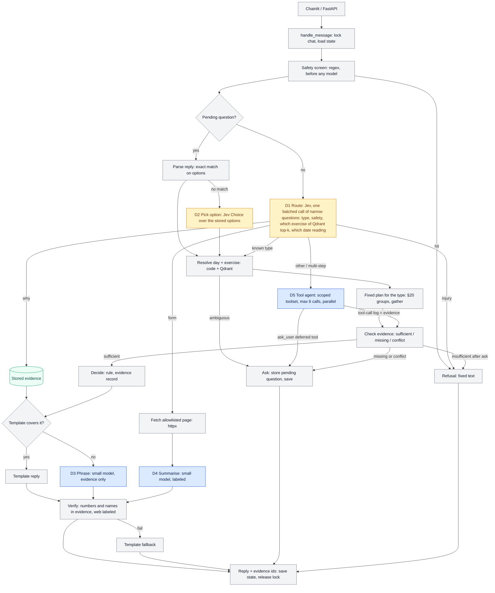
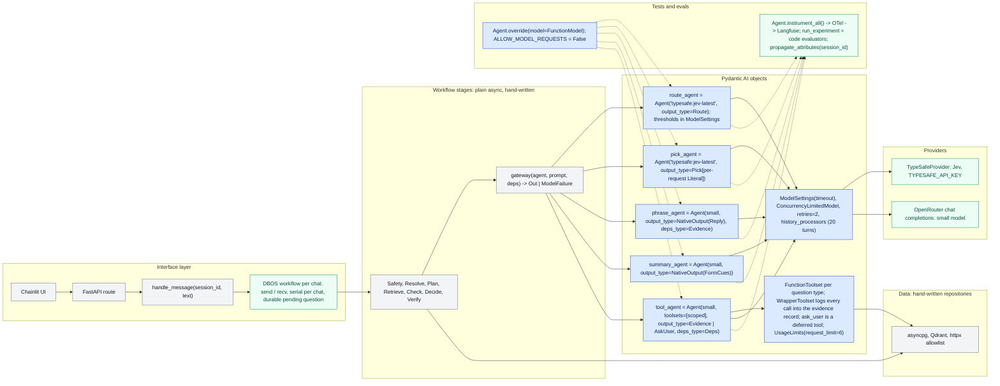

# Agentic workflow with Pydantic AI

Date 2026-10-06. Supersedes the §13 pipeline under the amended §12: a fixed graph, model decides only at named decision points with typed choices, code owns facts, safety, verification, state and bounds. Two paths through one graph: a fast path for the known question types (§20 plans, no orchestrator tokens) and a bounded tool loop only when routing says the plans do not cover it.

## 1. Workflow

Yellow = decision model (Jev, typed choice). Blue = generative model. Grey = code. Green = store.

Decision points, all typed, all bounded. Jev is a decisions model, not a chat model: it answers named questions of type Choice (up to 255 labels), Score or yes/no over a state text, all in one ~100 ms request, with per-field confidence, and writes no text. Pydantic AI 2.54.0 ships it natively: `pip install "pydantic-ai-slim[typesafe]"`, `TYPESAFE_API_KEY`, model string `typesafe:jev-latest`, class `TypeSafeModel`. An `Agent` with that model and an `output_type` whose fields are `bool`, `Literal` / `Enum` (2 to 255 options), a 0-to-1 float or an int rubric gets every field answered in one request; a `str` field is refused, and the docs say arithmetic, counting, dates and indirection are unreliable. Default tool output mode only. Low confidence raises unless `FallbackModel` escalates to a language model; thresholds are `decision_boolean_threshold` and `decision_route_threshold`; confidence sits in `result.response.provider_details['confidence']`. Entities therefore come from code: Qdrant top-k on the message gives exercise candidates, a date parser gives date-range readings, and Jev picks among them through a `Literal` built per request.

| Point | Model | In | Out | Budget |
|---|---|---|---|---|
| D1 Route | `Agent('typesafe:jev-latest', output_type=Route)` | message + last 2 turns; `Route` fields: `kind: Literal[10 types]`, `injury: bool`, `exercise: Literal[top-k + none]`, `date: Literal[readings]` | one request answers all fields; below threshold the stage asks instead of guessing | 1 call, every turn, ~100 ms |
| D2 Pick option | same model, `output_type=Pick` with a per-request `Literal` over the stored options + none | reply | index or none | 1 call, only when exact match fails |
| D3 Phrase | small model | evidence record | `Reply{text}` | 0 or 1 call; templates first |
| D4 Summarise | small model | page text | `FormCues{bullets}` | 1 call, form questions only |
| D5 Tool agent | small model | question, scoped toolset | `Evidence \| AskUser` | at most 6 tool calls, slow path only |

Fast path per turn: one Jev call, at most one small-model call, often none (template). Slow path: one Jev call plus up to seven small-model calls. Safety screen, evidence check and verify cannot be skipped by any decision. Published Jev accuracy is modest (vendor aggregate 67.8%; an independent test went from 62.6% with one broad question to 95% with five narrow ones), so D1 is built as several narrow questions, and the first eval compares Jev routing against small-model routing on the §25 sample set before Jev is trusted.

## 2. Interface level with Pydantic AI

Blue = Pydantic AI objects. Grey = hand-written. Green = external.

Tools, their contract and the inventory are in `docs/tools.md`.

Boundary rule: workflow stages never see an `Agent`; they call `gateway()` and get a typed value or a `ModelFailure`. One test double for all five agents: `FunctionModel` returning a tool call (Jev uses tool output mode, so the same double serves it). Low-confidence Jev answers become an Ask, not a `FallbackModel` escalation: §3 and §5 say ambiguity is asked, not guessed; `FallbackModel` is reserved for the question type only, if the eval shows Jev under-performs there. Jev Router (a chat-completions model id, free, routes to unpublished downstream models) is not used: the small model is pinned so cost and behaviour are measurable. Tools are the privacy boundary: they return queried rows with ids and units, typed "no rows" and "conflict" results instead of exceptions, and have no path to the date of birth or body measurements.

## 3. Models

Two models, no more. Jev (TypeSafe, $0.042 per M input, output free, ~100 ms) for every typed decision. One generative model for D3 phrasing, D4 page summary and D5 tool loop, same model for all three so there is one vocabulary, one eval and one bill. Jev cannot phrase, summarise or call tools, so the generative model is required; templates cover most fast-path answers, so it runs on a minority of turns.

**Price does not separate the candidates.** At 50 turns a day, mostly fast path, the generative model sees roughly 40k input and 5k output tokens a day. That is cents a month for the open-weight models and about $2 a month for the dearest proprietary one. Token efficiency comes from the design (Jev routing, templates, scoped toolsets, cached prefix, trimmed history), not from the model's price. Pick on verified tool reliability and latency with reasoning off.

| Candidate (research 2026-10-06, links in the teammates' tables) | $/M in / out | Verified tool evidence | Strict schema | TTFT |
|---|---|---|---|---|
| Claude Haiku 4.5 | 1.00 / 5.00 | τ²-bench retail 83.2 (third-party aggregator) | yes, strict tools | 0.69 s |
| GPT-6 Luna, reasoning off, Responses API | 0.10 / 0.50 | none published | yes | ~1.6 s (snippet only) |
| DeepSeek V4.1 Flash, non-thinking | 0.07 / 0.30 | vendor: MCPAtlas 64.0, Toolathlon 40.7 | varies by provider | not measured non-thinking |
| Qwen3.5-35B-A3B, thinking off | 0.08 / 0.75 | vendor: BFCL-V4 67.3, τ² 81.2 | yes | not measured non-thinking |
| gpt-oss-120b, low reasoning | 0.03 / 0.17 | none published | most providers | 1.2 s |
| granite4.1 8B local on M3 | 0 | vendor: BFCL v3 60.8 | Ollama `format` | ~14 tok/s, community figure |

Unverified across the board: BFCL v4 for the proprietary models (leaderboard did not render), parallel tool calls on Luna, Flash-Lite and Haiku, OpenRouter prices and latency, non-thinking latency for the open models.

**Recommendation: open-weight on OpenRouter.** Default to Qwen3.5-35B-A3B with thinking off: the only open candidate with published tool benchmarks (BFCL-V4 67.3, τ² 81.2, vendor-reported), JSON schema on its providers, pennies a month. First Langfuse experiment: the same 30 to 50 case dataset through Qwen3.5-35B-A3B, DeepSeek V4.1 Flash (non-thinking) and gpt-oss-120b (low reasoning), scored on tool trajectory accuracy, faithfulness (code-checked), outcome kind, then p50 latency. Keep the cheapest that ties; add a proprietary row (Haiku 4.5 or GPT-6 Luna) only if all three miss the budget, as a ceiling check. Reasoning off for every role. OpenRouter routing: pin one provider per model (`provider.order`, `allow_fallbacks: false`, `require_parameters: true` so structured output is guaranteed) and set `provider.data_collection: deny`; prefer a zero-retention route where one exists. Jev Router stays off: unpublished downstream models make cost and behaviour unmeasurable. Local granite is a fallback for D4 only, if privacy ever outranks latency; it is not a tool-loop candidate.

## 4. Open checks before phase 1

- Jev settled: native `TypeSafeModel` in Pydantic AI 2.54.0, tool output mode, no `str` fields. Entities come from Qdrant top-k and a date parser; Jev picks through a per-request `Literal`. Check the cost of building a Pydantic model per message, and that a 10-way `kind` plus three more fields stays under the 32k state budget with two turns of history.
- Jev docs say dates and counting are unreliable: date readings are computed by code and offered as labels, never asked of Jev.
- First eval: Jev routing versus small-model routing on the §25 sample set. Jev stays only if it matches on accuracy; its latency and price win is otherwise moot.
- Open-weight research could not verify parallel tool calls on any hosted provider, non-reasoning latency, or retention policies beyond Mistral's zero-retention route; granite 4.1 8B local (BFCL v3 60.8) is not a candidate for the tool loop.
- OpenRouter provider pinning from Pydantic AI: confirm the `OpenRouterModelSettings` field names for provider order, fallbacks and data collection.
- DBOS integration API for Pydantic AI 2.54 (`DBOSAgent` is deprecated; confirm the replacement).
- Budgets to measure in Langfuse from the first eval run: fast path p50 under 2 s and under 1.5k tokens; slow path p50 under 8 s and under 8k tokens; tool trajectory accuracy over 95%; faithfulness 100%, code-checked.
