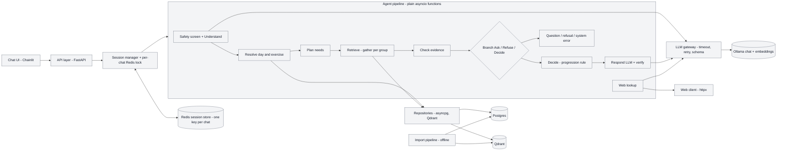
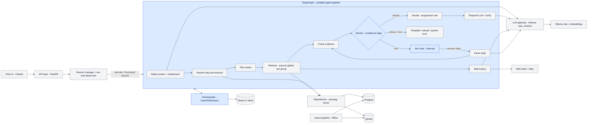
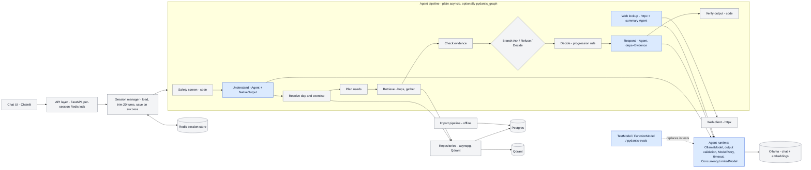

# Framework decision: the implementation spine

Date 2026-10-06. Two rounds. Round 1 evaluated the PDF's fixed pipeline under the original §12 (no model decisions) and is kept below as history. Round 2 re-ran the question after §9, §12 and §25 were reopened and the design became the agentic workflow in `docs/agentic-workflow.md` with the tools in `docs/tools.md`. Round 2 decides.

## Round 2: agentic workflow, Pydantic AI vs LangGraph

One test, `spikes/test_tool_loop.py` (130 lines, fakes inside: canned decider as the Jev stand-in, scripted generative model, counting repository, in-memory store). Four scenarios: fast path (code runs the plan, ambiguity asks, exact-match resume, one lookup each, phrased once, scripted model never stepped); session isolation with a system error; slow path (scripted tool loop: `find_exercise` → ambiguous → `ask_user` pauses → next message resumes the same loop → `recommend_weight` → `personal_record` → final text with an invented "99 kg" that verify must drop; evidence lists the four calls in order); a runaway script cut off at 6 tool calls. The decider is called once per new message and never on a resume. Combined run: `uv run --no-project --with pytest --with langgraph==1.2.13 --with pydantic-ai-slim==2.54.0 pytest spikes/test_tool_loop.py -q` gives `2 passed in 0.45s`.

| Spike | Result | Lines | Pinned |
|---|---|---|---|
| `spikes/pydantic_ai_loop.py` | 1 passed | 120 | pydantic-ai-slim 2.54.0, pydantic 2.13.5 |
| `spikes/langgraph_loop.py` | 1 passed | 120 | langgraph 1.2.13, langchain-core 1.6.6, no `langchain` |

| Design need | Pydantic AI | LangGraph |
|---|---|---|
| Decision point (Jev shape) | `Agent(FunctionModel, output_type=Route)`, same shape as the native `TypeSafeModel` | none; route node calls the decider directly |
| Tools shared by fast path and loop | one `FunctionToolset`; fast path calls the same functions through the same logger | `@tool` functions; fast node calls them directly; results must be JSON strings for `ToolNode` |
| Evidence per call | `WrapperToolset.call_tool` appends name, status, rows to deps | recovered from `ToolMessage`s after the loop |
| Pause on `ask_user` | `CallDeferred` → `DeferredToolRequests`; resume with `DeferredToolResults` + history via `ModelMessagesTypeAdapter` | `interrupt()` inside the tool; resume with `Command(resume=)` after `aget_state`; the tool superstep re-executes, and the fast node re-runs `find_exercise` on resume |
| Bound | `UsageLimits(tool_calls_limit=6)`, exact | `recursion_limit=14` in supersteps, indirect |
| State | the session store: pending {mode, options, history, log}; saved only on success (§15, §22 as written) | checkpointer per thread; `store.load/save` unused; per-message `REMOVE_ALL_MESSAGES` reset; two `aget_state` round-trips per message |
| Typed failures | `TimeoutError`, `UnexpectedModelBehavior`, `UsageLimitExceeded` mapped at one boundary | `TimeoutError` in route, `GraphRecursionError` at invoke; tool errors become `ToolNode` error messages |
| Test double | one `FunctionModel` for router and loop | a `BaseChatModel` subclass with a no-op `bind_tools` |
| Fought the test | nothing; 142 to 120 lines by removing blank lines | nothing blocking; interrupt-in-tool and the bound needed care |

Departures to fix in the real build, both spikes: `Route.exercise` is a `str` (Jev refuses `str`; production uses a `Literal` over Qdrant top-k), `personal_record` does not flag the 90 vs 85 conflict (`docs/tools.md` says it must), a catalog constant stands in for Qdrant ids, no `prepare` scoping.

**Verdict: Pydantic AI.** It owns exactly what the agentic design needs (decision agents in the Jev shape, toolsets with per-call logging, pause as a deferred tool call, an exact tool-call bound, one test double for every agent) and leaves state where the PDF put it: session store, lock, save on success. LangGraph passes the same test but repeats round 1's mismatch: the checkpointer replaces the session store, failure writes are kept, Redis needs Stack, the bound is in supersteps, and there is no decision-model abstraction. Fastest to finish: Pydantic AI. Best for learning tool design with an agent: Pydantic AI, since a tool is a typed function with an envelope and the model-facing surface is explicit; LangGraph teaches graph plumbing instead. Not close; no further framework experiment. The next experiment is the model and Jev eval on Langfuse.

## Round 1: fixed pipeline (superseded)

Candidates: plain asyncio (the PDF's own design, §13-§14), LangGraph 1.2.13, Pydantic AI 2.54.0 (used fully, with pydantic_graph). Model-driven agent frameworks were excluded by the original §12. Full per-framework tables with doc links: `docs/framework-evaluation/langgraph.md`, `docs/framework-evaluation/pydantic-ai.md`. The test every spike ran: `spikes/test_resume.py`. Rows 5 to 12 of the table below still hold under the new design; the verdict in section 4 does not.

## 1. Feature mapping, side by side

| Requirement | Plain asyncio (PDF) | LangGraph 1.2.13 | Pydantic AI 2.54.0 |
|---|---|---|---|
| 1. Fixed stage order, no model choice (§12, §16) | hand-written: sequential awaits | framework: `StateGraph` static edges | split: `pydantic_graph` fixes order, marginal over awaits |
| 2. Branch answer / ask / refuse / error (§5, §23) | hand-written: router over typed results | framework: conditional edges; router hand-written | split: typed graph decisions; router hand-written |
| 3. Parallel lookups in a sequential group (§17, §20) | hand-written: `asyncio.gather(return_exceptions=True)` | hand-written: gather in one node (`Send` discards partial results on one failure) | hand-written: gather (graph broadcast shares mutable state) |
| 4. Pause on a question, resume without re-running retrieval (§15, §16) | hand-written: pending question in session state, re-enter at the right stage | framework: `interrupt()` in its own Ask node + `Command(resume=)`; node restarts on resume; API decides resume vs fresh | hand-written: graph persistence removed in V2; deferred tools pause only on a model tool call |
| 5. Per-chat state, lock, Redis, saved only on success (§22) | hand-written: redis-py lock with expiry, save after success | split: `AsyncRedisSaver` saves per superstep and keeps failure writes; lock hand-written; needs Redis 8 / Stack | hand-written: Redis key + lock; `ModelMessagesTypeAdapter` serialises history |
| 6. Typed failures, not exceptions (§23) | hand-written: named failure results | hand-written: failure state field + edges; error handlers are post-hoc | hand-written: wrap `Agent.run`, convert `UnexpectedModelBehavior` / timeouts |
| 7. Structured output from Ollama, validate, retry (§18, §21) | hand-written: gateway over Ollama `format` + Pydantic + retry | hand-written: gateway (`with_structured_output` has no feedback retry) | framework: `OllamaModel` + `NativeOutput`, `ModelRetry` with the error, `retries={'output': 2}`; goes via Ollama `/v1` not native `format` |
| 8. Evidence into Respond, verify every number (§16) | hand-written | framework: state key flows; evidence + verify hand-written | framework: `deps_type=Evidence` + `instructions`; verify hand-written after the run |
| 9. Per-call timeouts, async end to end (§17) | hand-written: `asyncio.timeout` per call + request deadline | split: node timeouts (async only), `step_timeout`; per-call + deadline hand-written | framework: `ModelSettings(timeout)`, `ConcurrencyLimitedModel`; deadline + DB/web timeouts hand-written |
| 10. Fake model, failure injection (§25) | hand-written: fake in `llm/`, forced timeouts | framework: `context_schema` injection, `InMemorySaver`, `update_state`; fakes hand-written | framework: `FunctionModel` / `TestModel`, `Agent.override`, `capture_run_messages` |
| 11. History capped at 20 turns, no summary (§6) | hand-written: trim in session manager | hand-written: trim | framework: `history_processors`; 20-user-turn count hand-written |
| 12. Trace a request by session id (§14) | hand-written: stdlib logging + session id | split: LangSmith metadata (external); logging hand-written | framework: OTel spans + `metadata={'session_id'}`; logging hand-written |
| Rows the framework owns | 0 | 4 full, 3 split | 5 full, 5 split |
| Rows the framework fights | 0 | 3, 4, 5, 6 | 4, 6 (thin wrapper) |

## 2. Spikes

One test, `spikes/test_resume.py` (94 lines, fakes inside: canned model, call-counting repository, in-memory session store with a lock). "weight for squat tomorrow" must give a question with no lookups; a second session's "hack squat" must give a system error and must not see the first session's pending question; the first session's "hack squat" must give an answer with an evidence record, with the three lookups run exactly once and model calls exactly understand, understand, respond. Combined run: `uv run --no-project --with pytest --with langgraph==1.2.13 --with pydantic-ai-slim==2.54.0 pytest spikes/test_resume.py -q` gives `3 passed in 1.43s`.

| Spike | Result | Lines | Pinned versions |
|---|---|---|---|
| `spikes/plain_asyncio.py` | 1 passed | 100 | pytest 9.1.1, CPython 3.12.8, no other dependency |
| `spikes/langgraph_spike.py` | 1 passed | 96 | langgraph 1.2.13, langgraph-checkpoint 4.2.0, langgraph-prebuilt 1.1.0, langchain-core 1.6.6 |
| `spikes/pydantic_ai_spike.py` | 1 passed | 99 (148 with pydantic_graph) | pydantic-ai-slim 2.54.0, pydantic-graph 2.54.0, pydantic 2.13.5 |

**Plain asyncio.** Each stage is a closure returning the next context or a `Fail(kind, text)`; `Ask` is a `Fail` that also carries the stage to resume at, the field the reply fills, the context and the options. A seven-line loop runs the stages and stops at the first failure; any exception becomes `Fail("error")`; a two-line router makes the reply. `handle_message` follows §15 literally: lock, load, resume or run, save only on success. The ambiguity question resumes at Retrieve; the evidence check already issues an `Ask` resuming at Check, so the §15 pause reuses the same shape. Awkward: the resume point is a stage index in session state (a stage name would be safer) and context dicts are copied by hand. Not built: numeric reply parsing, the model fallback parser, the history cap, refusal after a failed ask.

**LangGraph.** Framework: `StateGraph` + `add_edge` for the order, three conditional edges plus the ask re-loop, `interrupt()` in its own Ask node, `Command(resume=)` when `aget_state` shows an interrupt, `InMemorySaver` keyed by `thread_id = session_id`, `durability="exit"`, `set_node_defaults(error_handler=)` turning exceptions into a `failure` state field (its signature needed source reading). Fakes injected by closure. Hand-written: `asyncio.gather` plus a check node for partial failures, the routers, a `FRESH` reset dict because state persists on a thread across runs, the history cap, evidence, rule, verify, safety regex. The test's `store.load/save` went unused: the checkpointer holds all state, so §15 "save only on success" becomes `durability="exit"` with failure writes retained, and production needs `langgraph-checkpoint-redis` on Redis 8 / Stack. Each message costs one extra `aget_state` round-trip. Resume at the Ask node after Resolve; the §15 pause would be a second interrupt node after Check with an edge back to Check.

**Pydantic AI.** Framework: two `Agent`s (Understand with `NativeOutput(Intent)`; Respond with `NativeOutput(Reply)`, `deps_type=dict` and an `@instructions` function rendering the evidence), `retries=2`, a five-line `FunctionModel` adapter around the canned model, `ALLOW_MODEL_REQUESTS = False`. Checked separately: malformed output gives three understand calls, then `UnexpectedModelBehavior`, then kind "error" with nothing saved. Hand-written: a `gateway()` converting `TimeoutError` / `UnexpectedModelBehavior` into a `ModelFailure` value, lock / load / save on success, safety regex, reply parsing, `asyncio.gather`, evidence check, rule, verify after the run. Resume: pending `{resume_at: "retrieve", candidates, intent}`; the §15 pause is `resume_at: "check"` plus partial evidence. The `pydantic_graph` variant passes at 148 lines: 49 lines for a State and a Deps dataclass, a class per node, an Entry node for mid-graph resume and builder wiring, buying only a typed answer / question branch. Friction: the evidence is carried twice (instructions and user prompt) because the fake echoes only the prompt.

## 3. Diagrams

Grey = hand-written or external service. Blue = owned by the framework.

### Plain asyncio (§13 as drawn; every box hand-written)

### LangGraph (owns the graph runtime, edges, branch, interrupt, checkpointer)

### Pydantic AI (owns the agent runs, output validation, retries, timeouts, test models)

## 4. Verdict

**Fastest to finish: Pydantic AI, but only as the gateway plus test models and evals on the PDF's plain spine.** "Used fully" does not exist for this design: the one non-gateway piece, `pydantic_graph`, has no persistence in V2 and cost 49 lines for a typed branch. It takes rows 7, 10 and 11 and the model half of row 9 off the hand-written list; everything in §15, §22 and §23 stays exactly as the PDF draws it. Cost: the `openai` SDK dependency, Ollama through `/v1` `response_format` instead of the native `format` parameter, an exception-to-typed-result wrapper, and the §24 reason "teaches the full mechanism" is given up.

**Best for learning how the pipeline works: plain asyncio.** The spike shows pause, resume, lock, typed failures and the gateway in 100 lines with nothing hidden; this is the reason §24 already gave. LangGraph is neither: it owns the cheap parts (edges, branch) and fights the expensive ones (save-on-success, the lock, partial results, one Redis key per chat, Redis Stack), and what you learn is LangGraph's state model rather than the pipeline's.

Plain and Pydantic AI are close because they differ only in the gateway. One experiment settles it: run §25's ~30 sample messages against the real granite4.1 through (a) an own gateway using Ollama's native `format` with Pydantic validation and retry, and (b) Pydantic AI `NativeOutput` over `/v1`; compare malformed-output rate, retries, p50 latency and the line count of (a). If (a) is under about 150 lines and matches (b), the own gateway wins on both axes.
