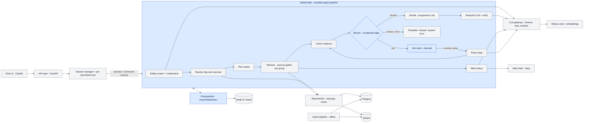

# LangGraph as the pipeline spine

Versions checked 2026-10-06: `langgraph` 1.2.13 ([PyPI](https://pypi.org/project/langgraph/), Python >=3.10, pulls in `langchain-core>=1.4.7`, `langgraph-checkpoint`, `langgraph-prebuilt`, `langgraph-sdk`, `xxhash`); `langgraph-checkpoint-redis` 0.5.2, released 2026-08-20 ([PyPI](https://pypi.org/project/langgraph-checkpoint-redis/), pulls in `redisvl`, `orjson`); `langchain-ollama` 1.1.0 ([PyPI](https://pypi.org/project/langchain-ollama/)). Per-node timeouts and error handlers need `langgraph>=1.2`.

## 1. Requirements vs LangGraph

| Requirement | LangGraph | Doc link |
|---|---|---|
| 1. Fixed stage order with no model choice (§12, §16) | framework provides: `StateGraph` with static `add_edge` between nodes. Nodes are plain async functions, so the model only picks the next step if you build a tool-calling agent, and this design doesn't. | [graph-api](https://docs.langchain.com/oss/python/langgraph/graph-api) |
| 2. Branch to answer / ask / refuse / system error (§5, §23) | framework provides: `add_conditional_edges(src, router, path_map)`, where a code function reads state and returns the next node name. hand-written: the router logic that maps the evidence-check result or a typed failure to an outcome. | [graph-api](https://docs.langchain.com/oss/python/langgraph/graph-api) |
| 3. Parallel lookups inside a sequential group (§17, §20) | framework provides: static fan-out/fan-in and `Send` map-reduce, where parallel nodes share one superstep. A superstep is transactional, though: "if any of these branches raises an exception, none of the updates are applied", which conflicts with §23 ("one failure does not hide the others; the evidence check sees the partial results"). hand-written: `asyncio.gather(..., return_exceptions=True)` inside one Retrieve node per group. | [use-graph-api](https://docs.langchain.com/oss/python/langgraph/use-graph-api) |
| 4. Pause on a question, store per chat, resume at the evidence check without re-running retrieval (§15, §16) | framework provides: `interrupt(payload)` with a checkpointer and `thread_id`, resumed by `Command(resume=value)`. On resume, "the runtime restarts the entire node from the beginning". Put `interrupt()` in its own Ask node after Check evidence. Retrieval ran in earlier supersteps and is checkpointed, so it is not re-run. hand-written: the API decides per message whether to send `Command(resume=text)` or a fresh run by inspecting `aget_state()`. Also hand-written: the reply-parsing node (simple parse, then model fallback), and the "user changed topic instead of answering" case. | [interrupts](https://docs.langchain.com/oss/python/langgraph/interrupts) |
| 5. Per-chat state with a lock, Redis-backed, saved only on success (§22) | framework provides: per-thread state through a checkpointer (`AsyncRedisSaver`, TTL via `default_ttl` in minutes plus `refresh_on_read`). It writes at every superstep, or only at exit/interrupt with `durability="exit"`. On failure it keeps the pending writes of nodes that succeeded. hand-written: the per-chat Redis lock. The OSS library has no per-thread serialization (`multitask_strategy` belongs to the Agent Server SDK, not the library). "Save only on success" is not the checkpointer's contract. | [checkpointers](https://docs.langchain.com/oss/python/langgraph/checkpointers), [langgraph-redis](https://github.com/redis-developer/langgraph-redis), [MultitaskStrategy](https://reference.langchain.com/python/langgraph-sdk/schema/MultitaskStrategy) |
| 6. Typed failures instead of exceptions (§23) | hand-written: nodes return a `failure` state field and a conditional edge routes on it. framework provides (>=1.2): node error handlers that run after retries are exhausted, receive `NodeError`, and can return a `Command` to update state and route. That converts exceptions after the fact; it is not typed results. | [timeout-and-error-handling](https://docs.langchain.com/oss/python/langgraph/timeout-and-error-handling) |
| 7. Structured output from a local Ollama model with schema validation and retry (§18, §21) | hand-written: the §14 LLM gateway. Optional framework help (`langchain-ollama`): `with_structured_output(method="json_schema")` is the default and uses Ollama's `format` structured-output API. `include_raw=True` exposes `parsing_error`. Neither retries with the validation error as feedback. Node `RetryPolicy` re-runs the whole node, and its default `retry_on` excludes `ValueError`, which Pydantic's `ValidationError` subclasses. | [ChatOllama.with_structured_output](https://reference.langchain.com/python/langchain-ollama/chat_models/ChatOllama/with_structured_output), [RetryPolicy](https://reference.langchain.com/python/langgraph/types/RetryPolicy) |
| 8. Passing evidence into the respond step and verifying every number in the reply against it (§16 Verify) | framework provides: an `evidence` state key flows from Decide to Respond to Verify. hand-written: the evidence record, the evidence-only prompt, and the number/date/name verifier with its template fallback. | [graph-api](https://docs.langchain.com/oss/python/langgraph/graph-api) |
| 9. Per-call timeouts; async-native end to end (§17) | framework provides: `ainvoke`/`astream`; `add_node(..., timeout=)` or `TimeoutPolicy(run_timeout, idle_timeout)` for async nodes only, which raises `NodeTimeoutError` ("retryable by default"); `step_timeout` per superstep. hand-written: per-lookup `asyncio.timeout` inside a gather (node timeouts are per node, not per call), the 90 s request deadline around `ainvoke`, and setting `retry_on` so only reads retry. | [timeout-and-error-handling](https://docs.langchain.com/oss/python/langgraph/timeout-and-error-handling), [Pregel.step_timeout](https://reference.langchain.com/python/langgraph/pregel/main/Pregel/step_timeout) |
| 10. Fake model for tests; failure injection (§25) | framework provides: `graph.nodes["x"].invoke()` for single nodes; `update_state(..., as_node=)` plus `interrupt_after` to start or stop mid-graph; `InMemorySaver` per test; `context_schema`/`Runtime` to inject dependencies. hand-written: the fake model, forced timeouts, and failing repositories. | [test](https://docs.langchain.com/oss/python/langgraph/test), [use-graph-api](https://docs.langchain.com/oss/python/langgraph/use-graph-api) |
| 11. Chat history capped at 20 turns, no summarisation (§6) | hand-written: trimming is "optional, not automatic". Use a plain list key with a trim in the final node, or `RemoveMessage` with `add_messages`. Summarisation is opt-in, so nothing to turn off. | [add-memory](https://docs.langchain.com/oss/python/langgraph/add-memory) |
| 12. Observability: tracing a request by session id (§14 logging) | framework provides: `config={"metadata": {...}, "tags": [...]}` attached to LangSmith traces (opt-in through `LANGSMITH_TRACING`, an external service). hand-written: stdlib logging with the session id, for example via a contextvar. Using `thread_id = session_id` keeps the two aligned. | [observability](https://docs.langchain.com/oss/python/langgraph/observability) |

## 2. LangGraph specifics

**StateGraph and state schema.** State is a `TypedDict` (recommended), a dataclass, or a Pydantic model. Pydantic is slower, the graph output "will NOT be an instance of a pydantic model", and "run-time validation only occurs on inputs to the first node". Each key has a reducer, and without one an update overwrites the key. `Annotated[list, add_messages]` appends. For this pipeline, plain overwrite keys suit everything except history. [graph-api](https://docs.langchain.com/oss/python/langgraph/graph-api), [use-graph-api](https://docs.langchain.com/oss/python/langgraph/use-graph-api)

**Conditional edges.** `add_conditional_edges("check_evidence", route, {"ask": ..., "refuse": ..., "decide": ..., "error": ...})`. The router is ordinary code, which fits §12. A node can instead return `Command(update=..., goto=...)`, but that hides edges from the static graph. [graph-api](https://docs.langchain.com/oss/python/langgraph/graph-api)

**Send vs gather.** `Send("node", substate)` fans out a dynamic number of tasks, such as one per exercise, and each result merges back through a reducer. The cost: a failing branch discards the whole superstep's updates, the exception escapes, and each lookup becomes a checkpointed task. §20's "items inside a group run together" wants partial results and typed failures. Plain `asyncio.gather(return_exceptions=True)` inside one Retrieve node does that directly. Gather is the simpler fit. [use-graph-api](https://docs.langchain.com/oss/python/langgraph/use-graph-api)

**interrupt() + Command(resume=).** It needs a checkpointer and `configurable.thread_id`. On resume the interrupted node restarts from its first line. Code before `interrupt()` re-runs and must be idempotent. Multiple interrupts in one node match by index. Row 4 holds only if `interrupt()` sits alone in an Ask node placed after Retrieve and Check evidence. Retrieve and Check are completed supersteps and do not re-run. The resume value (the user's next message) flows into a Parse node that edges back to Check evidence. Interrupts bypass retry policies and error handlers. The catch: the next message is ambiguous. It might answer the question, change topic, or say "new chat". The API layer must read `aget_state()` and decide between `Command(resume=text)` and a fresh input. [interrupts](https://docs.langchain.com/oss/python/langgraph/interrupts), [timeout-and-error-handling](https://docs.langchain.com/oss/python/langgraph/timeout-and-error-handling)

**Checkpointers.** `InMemorySaver` (alias `MemorySaver`) is included. `langgraph-checkpoint-redis` 0.5.2 provides `AsyncRedisSaver` and `AsyncShallowRedisSaver`; the shallow saver keeps only the latest checkpoint per thread. It stores checkpoint, writes and blobs as separate JSON documents, which is not "one key per chat". It requires RedisJSON and RediSearch (Redis 8+ or Redis Stack). TTL comes from `ttl={"default_ttl": minutes, "refresh_on_read": True}`; without it, checkpoints never expire. A pending question needing a longer life than idle expiry (§22) is not expressible per thread. [langgraph-redis](https://github.com/redis-developer/langgraph-redis), [PyPI](https://pypi.org/project/langgraph-checkpoint-redis/)

**thread_id + checkpointer and the lock.** A `thread_id` selects a checkpoint lineage, nothing more. The OSS runtime does not serialize two concurrent `ainvoke`s on one thread. The only documented concurrency control is the Agent Server's `multitask_strategy` (reject / interrupt / rollback / enqueue), which this project does not run. The §22 Redis lock with expiry stays hand-written, wrapped around `ainvoke`. Saving is per superstep, not per request. A checkpoint is written at each superstep boundary, and after a node failure "LangGraph stores pending checkpoint writes from any other nodes that completed successfully", so the next run resumes from them instead of rolling back. [checkpointers](https://docs.langchain.com/oss/python/langgraph/checkpointers), [MultitaskStrategy](https://reference.langchain.com/python/langgraph-sdk/schema/MultitaskStrategy)

**Durability modes.** `durability="exit"` saves only on completion or interrupt. `"async"` saves while the next step runs, with a small crash window. `"sync"` saves before each step. `exit` is the closest to §15's "save after the request completes", but it is still not atomic with the lock and still keeps failure writes. [checkpointers](https://docs.langchain.com/oss/python/langgraph/checkpointers)

**Retry and timeouts.** `RetryPolicy(initial_interval, backoff_factor, max_interval, max_attempts, jitter, retry_on)` applies per node. The default `retry_on` retries "any exception except" `ValueError`, `TypeError`, `OSError` and others, and retries HTTP errors only on 5xx. `add_node(timeout=...)`/`TimeoutPolicy` (>=1.2) applies per attempt, on async nodes only, and raises a retryable `NodeTimeoutError`. `set_node_defaults()` sets graph-wide defaults, which subgraphs do not inherit. `step_timeout` caps one superstep, not the request. [timeout-and-error-handling](https://docs.langchain.com/oss/python/langgraph/timeout-and-error-handling), [RetryPolicy](https://reference.langchain.com/python/langgraph/types/RetryPolicy), [step_timeout](https://reference.langchain.com/python/langgraph/pregel/main/Pregel/step_timeout)

**Typed failures.** LangGraph's own failure path is exceptions: retry, then error handler, then propagate. To keep §23, each node returns `{"failure": DbTimeout(...)}` and one conditional edge after each stage routes on it. Use error handlers only as a safety net for unexpected exceptions. [timeout-and-error-handling](https://docs.langchain.com/oss/python/langgraph/timeout-and-error-handling)

**Testing without a model.** Nodes stay plain async functions and can be unit-tested directly. In the graph, inject the fake gateway and repositories through `context_schema` and `runtime.context`, which are typed and kept out of state. Closures over a builder function also work, and `config["configurable"]` is the untyped legacy route. Compile a fresh `InMemorySaver` per test. `update_state(as_node="check_evidence")` seeds a paused state to test resume paths. §25's integration tests against real Redis also exercise the Redis checkpointer. [test](https://docs.langchain.com/oss/python/langgraph/test), [use-graph-api](https://docs.langchain.com/oss/python/langgraph/use-graph-api)

## 3. Architecture with LangGraph

Legend: blue = owned by LangGraph (graph runtime and edges, the conditional branch, `interrupt` and resume, the checkpointer). Grey = hand-written, or an external service. Every node body stays a hand-written async function.

## 4. What LangGraph forces you to do differently from the PDF

- **State shape.** The §14 `SessionStore` record (capped messages, last recommendation, pending question, user values) becomes a graph state schema with reducers. A pending question is no longer a stored field: it is an interrupted checkpoint plus its payload.
- **Where the lock lives.** It is still in the session manager around `ainvoke`. LangGraph adds nothing here, and the checkpointer must never be written outside the lock.
- **Save semantics change.** §15's rule that "state is saved only after the request completes, so a failed request cannot corrupt it" becomes per-superstep checkpoints, with failure writes retained. To keep the PDF rule, either use `durability="exit"` and accept the retained failure writes, or skip the checkpointer and save yourself. Without a checkpointer you lose `interrupt`.
- **Pause and resume.** The pause becomes an `interrupt()` in a dedicated node. The API must choose between resuming and starting fresh per message, and code before `interrupt()` re-runs.
- **Typed failures.** They live in a state field plus conditional edges after every stage. The framework's native path (retry, then error handler) is exception-based, and its default retry policy disagrees with §23 ("retries only for reads", "malformed output retry with feedback").
- **Parallel retrieval.** It stays as `asyncio.gather` inside a node. `Send` and superstep fan-out would lose the partial results §23 requires.
- **Extra dependencies.** `langgraph` (plus `langchain-core`, `langgraph-sdk`, `langgraph-prebuilt`, `xxhash`), and `langgraph-checkpoint-redis` with `redisvl`/`orjson`. Redis must be 8+ or Stack, with RedisJSON and RediSearch.
- **Changes to the §14 and §22 tables.** "Agent pipeline: plain asyncio functions" becomes "LangGraph StateGraph of async nodes". "Session store: redis-py behind SessionStore" becomes "AsyncRedisSaver checkpointer (multiple keys per thread, TTL in minutes)". "Redis, one key per chat" becomes "checkpoint, writes and blob keys per thread". "A pending question keeps the key alive longer" has no per-thread TTL override, so it stays hand-written or is dropped.
