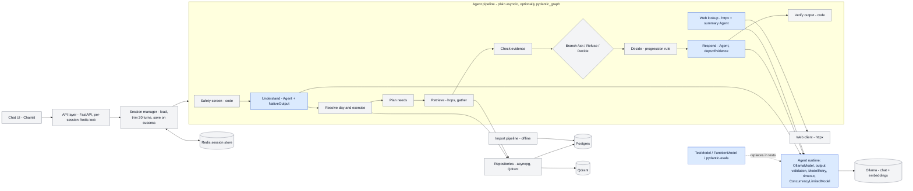

# Pydantic AI as the pipeline spine

Versions checked 2026-10-06: `pydantic-ai` **2.54.0** (PyPI, released 2026-10-03). Docs moved from `ai.pydantic.dev` to `pydantic.dev/docs/ai/` (301 redirects). Some features cited below (guardrails, `StepPersistence`) live in a separate `pydantic-ai-harness` package. `pydantic_graph` ships with it; its V2 **removed `pydantic_graph.persistence`**.

## 1. Requirements vs Pydantic AI

| Requirement | Pydantic AI | Doc link |
|---|---|---|
| 1. Fixed stage order with no model choice (§12, §16) | framework provides: `pydantic_graph` (BaseNode `run()` return annotations, or `GraphBuilder` edges) fixes the order in code, and the model never routes. But this is just ordinary control flow written as a graph, and 9 linear stages gain little over `await` calls. Each LLM stage is a separate `Agent.run` with no tools, so the agent loop has nothing to choose. hand-written: the stage functions. | [graph](https://pydantic.dev/docs/ai/graph/graph/), [builder](https://pydantic.dev/docs/ai/graph/builder/index.md) |
| 2. Branch to answer / ask / refuse / system error (§5, §23) | framework provides: typed branching through union return types (`BaseNode`) or `g.decision().branch(g.match(T))` matched with `isinstance`. hand-written: the router that maps stage failures to outcomes, and the four outcome types. The graph only dispatches on the types you return. | [decisions](https://pydantic.dev/docs/ai/graph/builder/decisions/index.md) |
| 3. Parallel lookups inside a sequential group (§17, §20) | framework provides (graph only): broadcast `.to(a,b,c)` / `.map()` + join with reducers, run on asyncio, all sharing mutable state ("be careful with mutations"). hand-written (simpler): `asyncio.gather(..., return_exceptions=True)` in the Retrieve stage, so one failure does not hide the others (§23). Tools are model-driven, so retrieval cannot be an Agent tool. | [parallel](https://pydantic.dev/docs/ai/graph/builder/parallel/index.md) |
| 4. Pause on a question, store per chat, resume at the evidence check without re-running retrieval (§15, §16) | hand-written. Graph persistence was removed in V2 ("Graph state is not snapshotted"). Deferred tools pause only on a *model-initiated* tool call. `StepPersistence` (harness) checkpoints *agent* runs, not a code pipeline. Store `PendingQuestion{partial_evidence, needs}` in the session, then enter the graph/pipeline at `CheckEvidence`. | [builder](https://pydantic.dev/docs/ai/graph/builder/index.md), [deferred tools](https://pydantic.dev/docs/ai/tools-toolsets/deferred-tools/) |
| 5. Per-chat state with a lock, Redis-backed, saved only on success (§22) | hand-written: Redis key + `redis.lock(timeout=…)`. Persistence docs list no Redis backend and say nothing about locking. framework provides: `ModelMessagesTypeAdapter` to serialise message history into the Redis value. | [persistence](https://pydantic.dev/docs/ai/core-concepts/persistence/), [message history](https://pydantic.dev/docs/ai/core-concepts/message-history/) |
| 6. Typed failures instead of exceptions (§23) | hand-written. The framework *raises*: `UnexpectedModelBehavior` (retries exhausted), `UsageLimitExceeded`, `RunCancelled`, plus provider/httpx timeout errors. Wrap every `Agent.run` in a gateway function that converts these to `ModelTimeout` / `MalformedOutput` results. | [agent](https://pydantic.dev/docs/ai/core-concepts/agent/), [timeouts](https://pydantic.dev/docs/ai/core-concepts/timeouts/index.md) |
| 7. Structured output from local Ollama with schema validation and retry (§18, §21) | framework provides: `OllamaModel` + `NativeOutput(Model)` sends `response_format: json_schema`, which self-hosted Ollama ≥0.5 enforces with llama.cpp grammar decoding. Pydantic validation, then `ModelRetry` with the error fed back, up to `retries={'output': 2}`. Caveat: this goes through Ollama's **OpenAI-compatible** `/v1` endpoint, not the native `format` parameter that §14 names. | [ollama](https://pydantic.dev/docs/ai/models/ollama/), [output](https://pydantic.dev/docs/ai/core-concepts/output/) |
| 8. Evidence into Respond; verify every number against it (§16 Verify) | framework provides: `deps_type=Evidence`, an `@agent.instructions` function rendering `ctx.deps`, and `@agent.output_validator` that can raise `ModelRetry`. hand-written: the number/date/name extractor and the matching. Run it **after** the agent, not as a validator, so a failure returns the template reply (§16) instead of spending a model retry. | [dependencies](https://pydantic.dev/docs/ai/core-concepts/dependencies/), [output](https://pydantic.dev/docs/ai/core-concepts/output/) |
| 9. Per-call timeouts; async end to end (§17) | framework provides: `ModelSettings(timeout=60)` per attempt, per-tool `timeout=`, and async `Agent.run`, so the model and its timeout are covered. hand-written: the request deadline ("no built-in mechanism", so use `asyncio.timeout`), plus the DB, Qdrant and web timeouts. Throttle: `ConcurrencyLimitedModel(limiter=1)` replaces the gateway semaphore. | [timeouts](https://pydantic.dev/docs/ai/core-concepts/timeouts/index.md), [concurrency](https://pydantic.dev/docs/ai/api/pydantic-ai/concurrency/index.md) |
| 10. Fake model for tests; failure injection (§25) | framework provides: `TestModel(custom_output_args=…)`, `FunctionModel` (a callable returning a `ModelResponse`, which can also raise or sleep to inject timeouts and malformed output), `Agent.override(model=…, deps=…)`, `ALLOW_MODEL_REQUESTS=False`, and `capture_run_messages`. hand-written: fakes for DB, Qdrant and web (§24 says real containers anyway). | [testing](https://pydantic.dev/docs/ai/guides/testing/) |
| 11. History capped at 20 user turns, no summarisation (§6) | framework provides: `history_processors` (sync/async, optional `RunContext`) to slice the history before each model call. hand-written: the "20 *user* turns" count (one turn spans several `ModelMessage`s) and the trim before saving (§15). With no tools in these agents, the tool-call pairing caveat does not arise. | [message history](https://pydantic.dev/docs/ai/core-concepts/message-history/) |
| 12. Observability: trace a request by session id (§14) | framework provides: OTel spans for agent runs and model requests through `Agent.instrument_all()` (any OTel backend, Logfire optional), plus `metadata={'session_id': …}` recorded on the agent span. hand-written: the session id in standard `logging` (§14), and spans for non-agent stages. | [logfire](https://pydantic.dev/docs/ai/integrations/logfire/), [agent](https://pydantic.dev/docs/ai/core-concepts/agent/) |

## 2. Pydantic AI specifics

**Agent, deps_type, RunContext.** `deps_type` is a type-checking hint, not a runtime value. Tools, instructions and validators receive `RunContext[Deps]` and read `ctx.deps`, and tests swap the deps with `agent.override(deps=…)`. You would define four small agents (Understand, ReplyParse, WebSummary, Respond), each with its own deps type. [link](https://pydantic.dev/docs/ai/core-concepts/dependencies/). Maps onto PDF component: LLM gateway (one Agent per §18 call).

**instructions vs system_prompt.** `instructions` are sent only for the current agent and are dropped from replayed `message_history`. `system_prompt` persists across history. The docs recommend `instructions`. That fits here: the Respond prompt is rebuilt per request from the evidence, so the stored history never carries an old prompt. [link](https://pydantic.dev/docs/ai/core-concepts/agent/index.md). Maps onto PDF component: prompt assembly inside Understand / Respond.

**output_type and output modes.** The default is `ToolOutput`, which presents the schema as an output tool and depends on granite's tool calling. `NativeOutput` uses `response_format=json_schema`, which local Ollama enforces through a grammar. `PromptedOutput` puts the schema in the prompt and is the least reliable. Ollama is configured as `OllamaModel('granite4.1:8b', provider=OllamaProvider(base_url='http://localhost:11434/v1'))`. `OllamaModel` subclasses `OpenAIChatModel`, so there is no native-API provider. Union `output_type` registers one output tool per member. [ollama](https://pydantic.dev/docs/ai/models/ollama/), [output](https://pydantic.dev/docs/ai/core-concepts/output/). Maps onto PDF component: LLM gateway schema check (use `NativeOutput`).

**Output validators and retries.** `@agent.output_validator` can raise `ModelRetry`, and each raise costs one unit of the output budget. Budgets: `retries=N` or `{'tools':…, 'output':…}` per agent or per run, and `ToolOutput(max_retries=)` or `@agent.tool(retries=)` per tool. When the budget is exhausted the run raises `UnexpectedModelBehavior`. Transport retries (`AsyncHTTPX2TenacityTransport`) are a separate layer that the agent never sees. [link](https://pydantic.dev/docs/ai/core-concepts/retries/index.md). Maps onto PDF component: LLM gateway retry (§23 "retry up to twice").

**Toolsets and code-called tools.** Toolsets (`FunctionToolset`, combined, filtered, prefixed, MCP) are exposed *to the model*. The docs offer no API for code to invoke a tool, so the workaround is calling the underlying function. [link](https://pydantic.dev/docs/ai/tools-toolsets/tools-advanced/index.md). Unused here: retrieval is code-driven (§18), and giving granite tools would bring back the model choosing steps (§12).

**Deferred tools / approvals.** `requires_approval`, `ApprovalRequired` and `CallDeferred` end the run with `DeferredToolRequests`. You resume with `message_history` plus `DeferredToolResults`. Every pause is triggered by a model tool call. [link](https://pydantic.dev/docs/ai/tools-toolsets/deferred-tools/). Unused here: the PDF's pending question comes from a code evidence check, not a model tool call, and resuming would re-enter the agent loop instead of the evidence check.

**message_history and history_processors.** Pass the history with `message_history=` and read it back with `result.new_messages()`. Processors can be sync or async and receive the message list. The docs warn that slicing can separate a tool call from its result, which does not apply to tool-free agents. Store the history as JSON with `ModelMessagesTypeAdapter`. [link](https://pydantic.dev/docs/ai/core-concepts/message-history/). Maps onto PDF component: Session manager (trim to 20 user turns, no summary).

**TestModel / FunctionModel.** `TestModel(custom_output_args={...})` returns canned structured output through the output tool. `TestModel()` with no arguments generates schema-valid random data. `FunctionModel(fn)` lets a test script the response, return malformed JSON, raise, or `await asyncio.sleep` past the timeout. `capture_run_messages()` lets a test assert retry prompts. [link](https://pydantic.dev/docs/ai/guides/testing/). Maps onto PDF component: §25 fake model and failure injection.

**pydantic-evals.** `Dataset` of `Case(inputs, expected_output)` with built-in exact-match and type evaluators, custom `Evaluator`s, `evaluate`/`evaluate_sync(max_concurrency=…)` and YAML datasets. It does not depend on pydantic-ai, and Logfire is optional. [link](https://pydantic.dev/docs/ai/evals/evals/). Maps onto PDF component: §25 "~30 sample messages with expected structured output" against real granite (set `max_concurrency=1`).

**Durable execution.** Temporal, DBOS, Prefect, Restate and AWS Lambda are co-maintained, and Kitaru, Airflow and Absurd are external. Each one wraps every model request and tool call as a durable unit. [link](https://pydantic.dev/docs/ai/capabilities/durable_execution/overview/). Unused here: each request takes seconds and a failure must leave state untouched (§15). Replaying is not required, and a workflow server is a heavy dependency.

**Logfire / OTel.** `logfire.instrument_pydantic_ai()` or `Agent.instrument_all(InstrumentationSettings(tracer_provider=…, include_content=False))` sends spans to any OTel backend. [link](https://pydantic.dev/docs/ai/integrations/logfire/). Unused here (optional): §14 calls for standard logging with a session id, and a `logging.Filter`/`contextvar` covers that. OTel helps only if per-stage latency on the 16 GB machine needs measuring.

**pydantic_graph.** `BaseNode[State, Deps, Out]` dataclasses take their edges from `run()` return annotations, `End[T]` ends the run, and `GraphRunContext` carries `state` and `deps`. `GraphBuilder` adds steps, typed decisions, and broadcast/map/join. `Graph.iter()` lets you drive execution step by step, and `render()` emits Mermaid. Persistence was removed in V2, so there is no per-chat pause/resume. You do get a fixed stage order and typed branching. [graph](https://pydantic.dev/docs/ai/graph/graph/), [builder](https://pydantic.dev/docs/ai/graph/builder/index.md). Unused here (marginal): a linear pipeline with one entry point (`CheckEvidence` on resume) is as clear in plain `async def` functions. The graph adds shared mutable state across parallel branches, which conflicts with "no shared mutable state" (§22). The one real gain is a generated diagram.

**Model settings, concurrency, usage.** `ModelSettings(timeout=…)` applies per attempt and is re-armed on SDK retries, so set `max_retries=0` on the OpenAI client or the 60 s budget multiplies. `ConcurrencyLimitedModel(model, limiter=1)` and a shared `ConcurrencyLimiter(max_running, max_queued)` replace the gateway semaphore. `UsageLimits(request_limit=3, output_tokens_limit=…)` caps retry loops. [timeouts](https://pydantic.dev/docs/ai/core-concepts/timeouts/index.md), [concurrency](https://pydantic.dev/docs/ai/api/pydantic-ai/concurrency/index.md). Maps onto PDF component: LLM gateway (timeout, concurrency limit).

## 3. Architecture with Pydantic AI

Legend: blue = owned by Pydantic AI (Agent runs, output validation, retries, model timeout and concurrency, test models, evals). Grey = hand-written. Embeddings stay a direct Ollama HTTP call, because Pydantic AI's Agent does not wrap them.

## 4. What Pydantic AI forces you to do differently from the PDF

- **The gateway becomes Agents plus a thin wrapper.** The "own wrapper over Ollama" (§14) shrinks to one function that calls `agent.run` and converts `UnexpectedModelBehavior`, timeouts and `UsageLimitExceeded` into typed results. The framework raises exceptions and the PDF wants typed results (§23), so this wrapper is still required.
- **Schema enforcement moves to `NativeOutput`, sent as `response_format` over Ollama's `/v1` OpenAI-compatible API**, not the native `format` schema parameter (§14, §24). Retry budgets live in `retries={'output':2}`, not in your loop. Turn off OpenAI SDK retries so they do not stack with yours.
- **Verify stays outside the agent.** Making it an `output_validator` would turn a failed check into a model retry, but §16 wants the template reply.
- **Fakes change:** tests use `Agent.override(model=FunctionModel(...))` instead of injecting a fake gateway object, and `ALLOW_MODEL_REQUESTS=False` guards the suite.
- **Pause/resume is still hand-written:** graph persistence is gone in V2, and deferred tools need a model tool call. The PendingQuestion in Redis and the entry at Check Evidence stay as designed.
- **Extra dependencies:** `pydantic-ai-slim[openai]` (pulls the `openai` SDK), and optionally `pydantic-graph`, `pydantic-evals` and `opentelemetry-sdk`. Skip `pydantic-ai-harness`, Logfire and durable backends.
- **PDF tables to update:** §14 "Language model gateway" changes to "Pydantic AI Agents (OllamaModel, NativeOutput) + a typed-result wrapper". §24 "Structured output" changes to PydanticAI, and the "teaches the full mechanism" argument for hand-writing is lost. §22 is unchanged, but the message format becomes `ModelMessage` JSON. §25 adds TestModel/FunctionModel and pydantic-evals.
